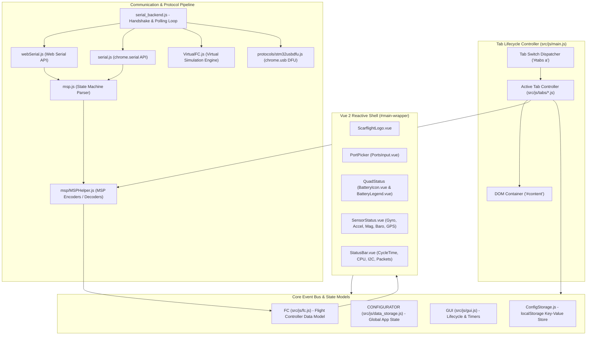

# 02 — Architecture, Module Relationships & Dependency Map

## 1. System Architecture Overview

Scarflight Configurator operates on an **event-driven, hybrid component architecture**. It combines:
1. **A Vue 2 Reactive Shell**: Rendering global application headers, status icons, brand logo, battery gauges, and the bottom status bar.
2. **A Dynamic Tab Controller System**: A jQuery-driven view-mounting engine that dynamically fetches and injects HTML templates into `#content`, initializing and disposing of specialized tab controllers.
3. **A Serial & Network Protocol Pipeline**: An abstraction layer translating raw serial and USB streams into the MultiWii Serial Protocol (MSP v1 / MSP v2), feeding a central Flight Controller model (`FC`).
4. **A Multi-Platform Hardware Bridge**: Conditional routing between Web Serial API (in browser), `chrome.serial` / `chrome.usb` (in NW.js desktop), and Cordova plugins (in mobile).

---

## 2. Core Execution Layers

### 2.1. Layer 1 — Application Bootstrap & Runtime Bridge
- **[`src/js/main.js`](file:///c:/Users/DELL/Drone/src/js/main.js)**:
  - Invoked upon `$(document).ready` ([`line 31`](file:///c:/Users/DELL/Drone/src/js/main.js#L31)).
  - Normalizes timer functions: In NW.js, rebinds `window.setTimeout` to `global.setTimeout` ([`lines 41–50`](file:///c:/Users/DELL/Drone/src/js/main.js#L41-L50)) to prevent background throttling when minimized.
  - Cleans up stale cache entries in `localStorage` ([`lines 68–88`](file:///c:/Users/DELL/Drone/src/js/main.js#L68-L88)).
  - Initializes internationalization via `i18n.init(...)` ([`line 95`](file:///c:/Users/DELL/Drone/src/js/main.js#L95)).
  - Invokes `initializeSerialBackend()` ([`line 110`](file:///c:/Users/DELL/Drone/src/js/main.js#L110)).
  - Binds tab switching clicks on `#tabs > ul a` ([`lines 257–464`](file:///c:/Users/DELL/Drone/src/js/main.js#L257-L464)).

### 2.2. Layer 2 — Global State & Models
- **[`src/js/fc.js`](file:///c:/Users/DELL/Drone/src/js/fc.js)**:
  - Central reactive model storing all flight controller parameters: `CONFIG`, `ANALOG`, `BATTERY_CONFIG`, `MOTOR_DATA`, `SERVO_DATA`, `RC`, `GPS_DATA`, `ATTITUDE`, `ARMING_DISABLE_FLAGS`.
  - Exposes `resetState()` to reinitialize clean default state between connections.
- **[`src/js/data_storage.js`](file:///c:/Users/DELL/Drone/src/js/data_storage.js)**:
  - Stores application-level session state: `connectionValid`, `virtualMode`, `virtualApiVersion`, `cliActive`, `version`, `gitRevision`.
- **[`src/js/gui.js`](file:///c:/Users/DELL/Drone/src/js/gui.js)**:
  - Singleton `GuiControl` tracking: `connecting_to`, `connected_to`, `connect_lock`, `active_tab`, `allowedTabs`.
  - Houses robust timer management methods: `interval_add`, `interval_remove`, `interval_kill_all`, `timeout_add`, `timeout_kill_all`.
  - Tab switch cleanup lifecycle: `tab_switch_cleanup(callback)` ensures timers and pending MSP callbacks are purged before mounting a new view.

### 2.3. Layer 3 — Protocol & Hardware Communication
- **[`src/js/msp.js`](file:///c:/Users/DELL/Drone/src/js/msp.js)**:
  - State machine processing incoming byte chunks. Supports:
    - **MSP V1**: `$M>` (incoming) / `$M<` (outgoing) with 8-bit length and XOR checksum.
    - **MSP V2**: `$X>` (incoming) / `$X<` (outgoing) with 16-bit length and DVB-S2 CRC-8 checksum.
    - **Jumbo Frames**: Handles frames with data payloads greater than 255 bytes.
- **[`src/js/msp/MSPHelper.js`](file:///c:/Users/DELL/Drone/src/js/msp/MSPHelper.js)**:
  - High-level command pipeline wrapping 100+ commands (e.g. `MSP_IDENT`, `MSP_STATUS`, `MSP_RAW_IMU`, `MSP_MOTOR`, `MSP_SET_PID`, `MSP_EEPROM_WRITE`).
  - Serializes JavaScript objects into binary packet buffers and parses responses into `FC`.

---

## 3. Dependency Map & Third-Party Library Inventory

The project depends on a curated collection of libraries for UI rendering, 3D graphics, data visualization, and device connectivity:

| Package | Version | Purpose in Application | Primary Callers / Importers |
| :--- | :--- | :--- | :--- |
| **`vue`** | `^2.7.10` | Reactive component framework for top bar, logo, status bar, and wizards | [`src/components/init.js`](file:///c:/Users/DELL/Drone/src/components/init.js), [`src/components/*`](file:///c:/Users/DELL/Drone/src/components) |
| **`three`** | `~0.97.0` | WebGL 3D rendering of animated drone airframe matching live gyro attitude | [`src/js/tabs/setup.js`](file:///c:/Users/DELL/Drone/src/js/tabs/setup.js), [`src/js/model.js`](file:///c:/Users/DELL/Drone/src/js/model.js) |
| **`d3`** | `^7.8.2` | Data-driven chart visualizations for sensors oscilloscope & PID rates | [`src/js/tabs/sensors.js`](file:///c:/Users/DELL/Drone/src/js/tabs/sensors.js), [`src/js/RateCurve.js`](file:///c:/Users/DELL/Drone/src/js/RateCurve.js) |
| **`ol`** | `^8.2.0` | OpenLayers map rendering live GPS satellite position and flight path | [`src/js/tabs/map.js`](file:///c:/Users/DELL/Drone/src/js/tabs/map.js), [`src/js/tabs/gps.js`](file:///c:/Users/DELL/Drone/src/js/tabs/gps.js) |
| **`jquery`** | `^3.6.3` | Core DOM manipulation, event dispatching, AJAX requests, tab switching | [`src/js/main.js`](file:///c:/Users/DELL/Drone/src/js/main.js), [`src/js/gui.js`](file:///c:/Users/DELL/Drone/src/js/gui.js), all tabs |
| **`jbox`** | `^1.3.3` | Tooltips (`cf_tip`, `cf_tip_wide`) and floating modal dialogs | [`src/js/gui.js`](file:///c:/Users/DELL/Drone/src/js/gui.js#L322-L350), [`src/js/tabs/*`](file:///c:/Users/DELL/Drone/src/js/tabs) |
| **`switchery-latest`** | `^0.8.2` | iOS-style toggle switches (`.togglesmall`, `.toggle`, `.togglemedium`) | [`src/js/gui.js:269`](file:///c:/Users/DELL/Drone/src/js/gui.js#L269) |
| **`select2`** | `^4.0.13` | Searchable dropdown list UI controls | [`src/js/tabs/presets/presets.js`](file:///c:/Users/DELL/Drone/src/tabs/presets/presets.js), [`src/tabs/*`](file:///c:/Users/DELL/Drone/src/tabs) |
| **`multiple-select`** | `^1.6.0` | Multi-option checkbox dropdown component | [`src/js/tabs/ports.js`](file:///c:/Users/DELL/Drone/src/js/tabs/ports.js) |
| **`i18next`** | `^19.0.0` | Localization engine managing 19 languages and translation keys | [`src/js/localization.js`](file:///c:/Users/DELL/Drone/src/js/localization.js) |
| **`bonjour`** | `^3.5.0` | Zeroconf/mDNS service discovery in Node/NW.js desktop mode | [`src/js/mdns_discovery.js`](file:///c:/Users/DELL/Drone/src/js/mdns_discovery.js#L54) |
| **`crypto-es`** | `^2.1.0` | Cryptographic hashing for firmware signatures and config hashing | [`src/js/serial_backend.js`](file:///c:/Users/DELL/Drone/src/js/serial_backend.js#L23) |
| **`marked`** | `^4.1.1` | Markdown parser for rendering changelogs and preset documentation | [`src/js/tabs/presets/*`](file:///c:/Users/DELL/Drone/src/tabs/presets), [`src/js/tabs/static_tab.js`](file:///c:/Users/DELL/Drone/src/js/tabs/static_tab.js) |
| **`dompurify`** | `^2.4.0` | HTML sanitizer preventing XSS attacks when rendering parsed markdown | [`src/js/tabs/presets/*`](file:///c:/Users/DELL/Drone/src/tabs/presets) |
| **`semver-min`** | `^0.7.2` | Semantic version parsing for API compatibility gating | [`src/js/fc.js`](file:///c:/Users/DELL/Drone/src/js/fc.js), [`src/js/serial_backend.js`](file:///c:/Users/DELL/Drone/src/js/serial_backend.js) |
| **`@fortawesome/fontawesome-free`** | `^6.5.1` | Vector icon set (menu bars, ellipses, warnings, arrows) | [`src/index.html`](file:///c:/Users/DELL/Drone/src/index.html), [`src/main.html`](file:///c:/Users/DELL/Drone/src/main.html) |

---

## 4. Architectural Analysis: Constraints, Circularities & Dead Code

### 4.1. Circular Dependencies
- **`serial_backend.js` <-> `msp/MSPHelper.js`**:
  - Identified in [`src/js/serial_backend.js:3-4`](file:///c:/Users/DELL/Drone/src/js/serial_backend.js#L3-L4):
    `// NOTE: this is a circular dependency, needs investigating`
    `import MspHelper from "./msp/MSPHelper";`
  - While ESM module hoisting avoids runtime crashes in standard execution, this tight coupling makes isolated unit testing of `serial_backend.js` challenging without mocking `MSPHelper`.

### 4.2. Confirmed Dead / Unreferenced Code
- **[`src/js/GitHubApi.js`](file:///c:/Users/DELL/Drone/src/js/GitHubApi.js)**:
  - Identified via grep search across entire codebase. Line 1 explicitly states:
    `// NOTE: this files seems to be unused anywhere`
  - No active imports or references exist in any JavaScript or Vue file.

### 4.3. Legacy Architectural Artifacts
- **Global `window.vm` & `window.ConfigStorage`**:
  - In [`src/components/init.js:56`](file:///c:/Users/DELL/Drone/src/components/init.js#L56), the model is attached directly to `window.vm = ScarflightModel` so legacy jQuery code can trigger reactive Vue updates.
- **Chrome App API Shims**:
  - The codebase originally ran as a Google Chrome App. References to `chrome.serial`, `chrome.usb`, `chrome.fileSystem`, and `chrome.sockets.tcp` persist throughout `serial.js`, `stm32usbdfu.js`, and `gui.js`. In NW.js desktop, these are provided by NW.js Chromium shims. In the browser preview, `webSerial.js` replaces `chrome.serial`.
