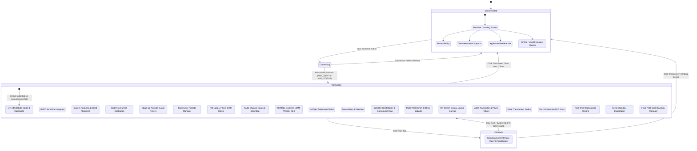

# 03 — Pages, Routes & Navigation System

## 1. Navigation Architecture Overview

Betaflight Configurator does not use a traditional URL hash or HTML5 pushState router (such as `vue-router`). Instead, it employs an **event-driven tab switching state machine** implemented in [`src/js/main.js:257–464`](file:///c:/Users/DELL/Drone/src/js/main.js#L257-L464) and controlled by the `GuiControl` singleton in [`src/js/gui.js`](file:///c:/Users/DELL/Drone/src/js/gui.js).

### Navigation State Rules
1. **Disconnected Mode (`mode-disconnected`)**:
   - Only offline informational, setup, and firmware flashing tabs are accessible.
   - Default allowed list: `landing`, `firmware_flasher`, `privacy_policy`, `options`, `help` ([`gui.js:29–35`](file:///c:/Users/DELL/Drone/src/js/gui.js#L29-L35)).
2. **Connected Mode (`mode-connected`)**:
   - Unlocked upon successful MSP handshake with a physical or virtual Flight Controller.
   - Allowed list expands to all flight configuration, sensor, and tuning tabs ([`gui.js:37–65`](file:///c:/Users/DELL/Drone/src/js/gui.js#L37-L65)).
   - Tabs requiring specific hardware features (e.g. `gps`, `led_strip`, `osd`, `servos`, `transponder`) are dynamically shown or hidden via `updateTabList(features)` based on `FC.FEATURE_CONFIG.features` ([`src/js/utils/updateTabList.js`](file:///c:/Users/DELL/Drone/src/js/utils/updateTabList.js)).
3. **CLI Mode (`mode-connected-cli`)**:
   - When entering the Command Line Interface tab (`cli`), all normal MSP telemetry polling intervals are paused, and the serial pipeline switches exclusively to raw character transmission. Exiting the CLI tab triggers an automatic FC soft reboot.

---

## 2. Navigation State Machine Diagram

---

## 3. Master Inventory of Pages, Tabs & Views

The repository contains **27 sidebar-routed tabs**, **1 auxiliary popup window**, **2 non-routed template files**, and **1 tab sub-module**:

### 3.1. Routed Sidebar Navigation Tabs (27 Tabs)

These 27 tabs are defined in [`src/main.html:26–55`](file:///c:/Users/DELL/Drone/src/main.html#L26-L55) within the `#tabs` navigation list and dispatched via the `switch (tab)` block in [`src/js/main.js:318–458`](file:///c:/Users/DELL/Drone/src/js/main.js#L318-L458):

| # | Tab Internal Identifier | Display Name (English) | CSS Class Selector | HTML Markup Template | JS Controller File | Mode Prerequisite | Status |
| :---: | :--- | :--- | :--- | :--- | :--- | :--- | :--- |
| **1** | `landing` | Welcome | `.tab_landing` | [`src/tabs/landing.html`](file:///c:/Users/DELL/Drone/src/tabs/landing.html) | [`src/js/tabs/landing.js`](file:///c:/Users/DELL/Drone/src/js/tabs/landing.js) | `mode-disconnected` | ✅ Verified |
| **2** | `privacy_policy` | Privacy Policy | `.tab_privacy_policy` | [`src/tabs/privacy_policy.html`](file:///c:/Users/DELL/Drone/src/tabs/privacy_policy.html) | [`src/js/tabs/static_tab.js`](file:///c:/Users/DELL/Drone/src/js/tabs/static_tab.js) | `mode-disconnected` | ✅ Verified |
| **3** | `help` | Documentation & Support | `.tab_help` | [`src/tabs/help.html`](file:///c:/Users/DELL/Drone/src/tabs/help.html) | [`src/js/tabs/help.js`](file:///c:/Users/DELL/Drone/src/js/tabs/help.js) | `mode-disconnected` | ✅ Verified |
| **4** | `options` | Options | `.tab_options` | [`src/tabs/options.html`](file:///c:/Users/DELL/Drone/src/tabs/options.html) | [`src/js/tabs/options.js`](file:///c:/Users/DELL/Drone/src/js/tabs/options.js) | `mode-disconnected` | ✅ Verified |
| **5** | `firmware_flasher` | Firmware Flasher | `.tab_firmware_flasher` | [`src/tabs/firmware_flasher.html`](file:///c:/Users/DELL/Drone/src/tabs/firmware_flasher.html) | [`src/js/tabs/firmware_flasher.js`](file:///c:/Users/DELL/Drone/src/js/tabs/firmware_flasher.js) | `mode-disconnected` | ✅ Verified |
| **6** | `setup` | Setup | `.tab_setup` | [`src/tabs/setup.html`](file:///c:/Users/DELL/Drone/src/tabs/setup.html) | [`src/js/tabs/setup.js`](file:///c:/Users/DELL/Drone/src/js/tabs/setup.js) | `mode-connected` | ✅ Verified |
| **7** | `setup_osd` | Standalone OSD Setup | `.tab_setup_osd` | [`src/tabs/setup_osd.html`](file:///c:/Users/DELL/Drone/src/tabs/setup_osd.html) | [`src/js/tabs/setup_osd.js`](file:///c:/Users/DELL/Drone/src/js/tabs/setup_osd.js) | `mode-connected` (OSD Board) | ✅ Verified |
| **8** | `ports` | Ports | `.tab_ports` | [`src/tabs/ports.html`](file:///c:/Users/DELL/Drone/src/tabs/ports.html) | [`src/js/tabs/ports.js`](file:///c:/Users/DELL/Drone/src/js/tabs/ports.js) | `mode-connected` | ✅ Verified |
| **9** | `configuration` | Configuration | `.tab_configuration` | [`src/tabs/configuration.html`](file:///c:/Users/DELL/Drone/src/tabs/configuration.html) | [`src/js/tabs/configuration.js`](file:///c:/Users/DELL/Drone/src/js/tabs/configuration.js) | `mode-connected` | ✅ Verified |
| **10** | `power` | Power & Battery | `.tab_power` | [`src/tabs/power.html`](file:///c:/Users/DELL/Drone/src/tabs/power.html) | [`src/js/tabs/power.js`](file:///c:/Users/DELL/Drone/src/js/tabs/power.js) | `mode-connected` | ✅ Verified |
| **11** | `failsafe` | Failsafe | `.tab_failsafe` | [`src/tabs/failsafe.html`](file:///c:/Users/DELL/Drone/src/tabs/failsafe.html) | [`src/js/tabs/failsafe.js`](file:///c:/Users/DELL/Drone/src/js/tabs/failsafe.js) | `mode-connected` | ✅ Verified |
| **12** | `presets` | Presets | `.tab_presets` | [`src/tabs/presets/presets.html`](file:///c:/Users/DELL/Drone/src/tabs/presets/presets.html) | [`src/tabs/presets/presets.js`](file:///c:/Users/DELL/Drone/src/tabs/presets/presets.js) | `mode-connected` | ✅ Verified |
| **13** | `pid_tuning` | PID Tuning | `.tab_pid_tuning` | [`src/tabs/pid_tuning.html`](file:///c:/Users/DELL/Drone/src/tabs/pid_tuning.html) | [`src/js/tabs/pid_tuning.js`](file:///c:/Users/DELL/Drone/src/js/tabs/pid_tuning.js) | `mode-connected` | ✅ Verified |
| **14** | `receiver` | Receiver | `.tab_receiver` | [`src/tabs/receiver.html`](file:///c:/Users/DELL/Drone/src/tabs/receiver.html) | [`src/js/tabs/receiver.js`](file:///c:/Users/DELL/Drone/src/js/tabs/receiver.js) | `mode-connected` | ✅ Verified |
| **15** | `auxiliary` | Modes | `.tab_auxiliary` | [`src/tabs/auxiliary.html`](file:///c:/Users/DELL/Drone/src/tabs/auxiliary.html) | [`src/js/tabs/auxiliary.js`](file:///c:/Users/DELL/Drone/src/js/tabs/auxiliary.js) | `mode-connected` | ✅ Verified |
| **16** | `adjustments` | Adjustments | `.tab_adjustments` | [`src/tabs/adjustments.html`](file:///c:/Users/DELL/Drone/src/tabs/adjustments.html) | [`src/js/tabs/adjustments.js`](file:///c:/Users/DELL/Drone/src/js/tabs/adjustments.js) | `mode-connected` | ✅ Verified |
| **17** | `servos` | Servos | `.tab_servos` | [`src/tabs/servos.html`](file:///c:/Users/DELL/Drone/src/tabs/servos.html) | [`src/js/tabs/servos.js`](file:///c:/Users/DELL/Drone/src/js/tabs/servos.js) | `mode-connected` (Feature: `SERVOS`) | ✅ Verified |
| **18** | `gps` | GPS | `.tab_gps` | [`src/tabs/gps.html`](file:///c:/Users/DELL/Drone/src/tabs/gps.html) | [`src/js/tabs/gps.js`](file:///c:/Users/DELL/Drone/src/js/tabs/gps.js) | `mode-connected` (Feature: `GPS`) | ✅ Verified |
| **19** | `motors` | Motors | `.tab_motors` | [`src/tabs/motors.html`](file:///c:/Users/DELL/Drone/src/tabs/motors.html) | [`src/js/tabs/motors.js`](file:///c:/Users/DELL/Drone/src/js/tabs/motors.js) | `mode-connected` | ✅ Verified |
| **20** | `osd` | OSD | `.tab_osd` | [`src/tabs/osd.html`](file:///c:/Users/DELL/Drone/src/tabs/osd.html) | [`src/js/tabs/osd.js`](file:///c:/Users/DELL/Drone/src/js/tabs/osd.js) | `mode-connected` (Feature: `OSD`) | ✅ Verified |
| **21** | `vtx` | Video Transmitter | `.tab_vtx` | [`src/tabs/vtx.html`](file:///c:/Users/DELL/Drone/src/tabs/vtx.html) | [`src/js/tabs/vtx.js`](file:///c:/Users/DELL/Drone/src/js/tabs/vtx.js) | `mode-connected` (Feature: `VTX`) | ✅ Verified |
| **22** | `transponder` | Transponder | `.tab_transponder` | [`src/tabs/transponder.html`](file:///c:/Users/DELL/Drone/src/tabs/transponder.html) | [`src/js/tabs/transponder.js`](file:///c:/Users/DELL/Drone/src/js/tabs/transponder.js) | `mode-connected` (Feature: `TRANSPONDER`) | ✅ Verified |
| **23** | `led_strip` | LED Strip | `.tab_led_strip` | [`src/tabs/led_strip.html`](file:///c:/Users/DELL/Drone/src/tabs/led_strip.html) | [`src/js/tabs/led_strip.js`](file:///c:/Users/DELL/Drone/src/js/tabs/led_strip.js) | `mode-connected` (Feature: `LED_STRIP`) | ✅ Verified |
| **24** | `sensors` | Sensors | `.tab_sensors` | [`src/tabs/sensors.html`](file:///c:/Users/DELL/Drone/src/tabs/sensors.html) | [`src/js/tabs/sensors.js`](file:///c:/Users/DELL/Drone/src/js/tabs/sensors.js) | `mode-connected` | ✅ Verified |
| **25** | `logging` | Tethered Logging | `.tab_logging` | [`src/tabs/logging.html`](file:///c:/Users/DELL/Drone/src/tabs/logging.html) | [`src/js/tabs/logging.js`](file:///c:/Users/DELL/Drone/src/js/tabs/logging.js) | `mode-connected` (Feature: `BLACKBOX`) | ✅ Verified |
| **26** | `onboard_logging` | Blackbox | `.tab_onboard_logging` | [`src/tabs/onboard_logging.html`](file:///c:/Users/DELL/Drone/src/tabs/onboard_logging.html) | [`src/js/tabs/onboard_logging.js`](file:///c:/Users/DELL/Drone/src/js/tabs/onboard_logging.js) | `mode-connected` (Dataflash / SD) | ✅ Verified |
| **27** | `cli` | CLI | `.tab_cli` | [`src/tabs/cli.html`](file:///c:/Users/DELL/Drone/src/tabs/cli.html) | [`src/js/tabs/cli.js`](file:///c:/Users/DELL/Drone/src/js/tabs/cli.js) | `mode-connected-cli` | ✅ Verified |

### 3.2. Auxiliary Popup Window (Desktop / Chrome App Only)

| Internal Identifier | Display Name | Markup Template | JS Controller | Launch Mechanism | Status |
| :--- | :--- | :--- | :--- | :--- | :--- |
| `receiver_msp` | MSP Receiver | [`src/tabs/receiver_msp.html`](file:///c:/Users/DELL/Drone/src/tabs/receiver_msp.html) | [`src/js/tabs/receiver_msp.js`](file:///c:/Users/DELL/Drone/src/js/tabs/receiver_msp.js) | `chrome.app.window.create("/tabs/receiver_msp.html", { id: "receiver_msp" })` called from `receiver.js:540` | ✅ Active auxiliary window (desktop mode only) |

### 3.3. Non-Routed Template Files (`src/tabs/`)

| File Path | Lines | Purpose & Description | Routing Status |
| :--- | :---: | :--- | :--- |
| [`src/tabs/blank.html`](file:///c:/Users/DELL/Drone/src/tabs/blank.html) | 1 | Single `
`. | Active loading transition placeholder |
| [`src/tabs/review.html`](file:///c:/Users/DELL/Drone/src/tabs/review.html) | 11 | "Rate this app" modal dialog with i18n keys `reviewhead`, `reviewInitial`, `reviewStore`, `reviewBug`, `reviewYes`, `reviewNo`. None of these keys exist in any of the 19 locale files. Not referenced in `main.js`, `gui.js`, `index.html`, or `main.html`. | ⚠️ Orphaned dead code (inferred legacy dialog from Chrome App/Cordova build) |

### 3.4. Tab Sub-Modules (`src/js/tabs/`)

| File Path | Lines | Description | Primary Consumer |
| :--- | :---: | :--- | :--- |
| [`src/js/tabs/map.js`](file:///c:/Users/DELL/Drone/src/js/tabs/map.js) | 137 (138 total) | Dedicated OpenLayers map helper module exporting `initMap()`. Configures OSM, Google Satellite, and Google Hybrid tile layers; adds GPS/Mag/NoFix position icon markers; and binds map view toggle buttons. | Imported by [`src/js/tabs/gps.js:12`](file:///c:/Users/DELL/Drone/src/js/tabs/gps.js#L12) |

> [!NOTE]
> **Broken Route Notice (`changelog`)**: [`src/js/main.js:324–328`](file:///c:/Users/DELL/Drone/src/js/main.js#L324-L328) contains a switch case for `case 'changelog': import("./tabs/static_tab").then(({ staticTab }) => staticTab.initialize("changelog", content_ready));`. However, `src/tabs/changelog.html` does not exist on disk, resulting in a 404 load error when triggered.

---

## 4. Tab Lifecycle & Transition Chain

When a user clicks any navigation link `$('#tabs > ul a')`, the execution follows this exact call sequence:

1. **Guard Checks ([`main.js:258–287`](file:///c:/Users/DELL/Drone/src/js/main.js#L258-L287))**:
   - Verifies `!GUI.tab_switch_in_progress`.
   - Checks if tab is already active (`!$(this).parent().hasClass('active')`).
   - Verifies `CONFIGURATOR.connectionValid` if tab requires connection (`mode-connected`).
   - Checks `!GUI.connect_lock` (aborts if a flash or save operation is currently writing).
   - Validates whether the tab is in `GUI.allowedTabs`.
2. **Locking & Cleanup ([`main.js:289–309`](file:///c:/Users/DELL/Drone/src/js/main.js#L289-L309))**:
   - Sets `GUI.tab_switch_in_progress = true`.
   - Calls `GUI.tab_switch_cleanup(callback)`:
     - Clears pending MSP callbacks via `MSP.callbacks_cleanup()` ([`gui.js:260`](file:///c:/Users/DELL/Drone/src/js/gui.js#L260)).
     - Kills all running timers via `GUI.interval_kill_all()` ([`gui.js:261`](file:///c:/Users/DELL/Drone/src/js/gui.js#L261)).
     - Calls previous tab's `cleanup(callback)` hook ([`gui.js:264`](file:///c:/Users/DELL/Drone/src/js/gui.js#L264)).
   - Clears `#content` and appends loading spinner `#cache .data-loading`.
3. **Dynamic Controller Loading ([`main.js:318–459`](file:///c:/Users/DELL/Drone/src/js/main.js#L318-L459))**:
   - Executes dynamic `import("./tabs/<tab_name>").then(({ <tab_name> }) => <tab_name>.initialize(content_ready))` code split.
4. **Content Initialization & DOM Binding**:
   - Loads the tab's HTML template into `#content`.
   - Registers tab-specific event listeners and sets input values from `FC`.
   - Calls `GUI.content_ready()` ([`gui.js:309–355`](file:///c:/Users/DELL/Drone/src/js/gui.js#L309-L355)):
     - Reinitializes `Switchery` toggles (`.toggle`, `.togglesmall`).
     - Binds `jBox` tooltips (`.cf_tip`, `.cf_tip_wide`).
     - Updates header documentation button link to `https://betaflight.com/docs/wiki/configurator/<tab-name>-tab`.
5. **Release Lock**:
   - Calls `content_ready()`, resetting `GUI.tab_switch_in_progress = false`.
