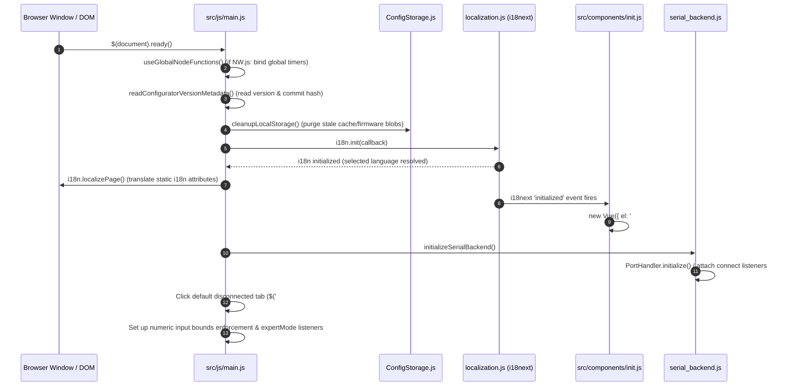

# 06 — Feature Workflows & End-to-End Execution Sequences

This document provides step-by-step, source-backed execution flows for the core features and subsystems of Betaflight Configurator.

---

## Workflow 1: Application Startup & Initialization Sequence



---

## Workflow 2: Serial / WebSerial Connection & Handshake

```mermaid
sequenceDiagram
    autonumber
    participant User as Pilot / User
    participant Backend as serial_backend.js
    participant Driver as webSerial.js / serial.js
    participant MSP as msp.js
    participant Helper as msp/MSPHelper.js
    participant FC as fc.js
    participant GUI as gui.js

    User->>Backend: Click 'Connect' button
    Backend->>Backend: Lock UI port selectors; set state 'Connecting...'
    Backend->>Driver: serial.connect(portName, { baudrate })
    Driver-->>Backend: Connection opened (connectionId assigned)
    Backend->>Driver: serial.addEventListener('receive', onReceive)
    
    rect rgb(240, 248, 255)
        Note over Backend, Helper: Handshake Initialization Wave
        Backend->>Helper: MSP.send_message(MSP_API_VERSION)
        Driver->>MSP: Incoming byte stream ($M> or $X>)
        MSP->>Helper: Decoded packet (code, payload)
        Helper->>FC: Update FC.CONFIG.apiVersion
        Backend->>Helper: MSP.send_message(MSP_FC_VARIANT) -> 'BTFL' verified
        Backend->>Helper: MSP.send_message(MSP_FC_VERSION) -> parse version (e.g. 4.5.0)
        Backend->>Helper: MSP.send_message(MSP_BUILD_INFO)
        Backend->>Helper: MSP.send_message(MSP_BOARD_INFO) -> target name, signature
        Backend->>Helper: MSP.send_message(MSP_FEATURE_CONFIG) -> active features
    end

    Backend->>GUI: GUI.selectDefaultTabWhenConnected() (opens Setup tab)
    Backend->>Backend: Start live data refresh polling loop (intervals for MSP_ANALOG, MSP_STATUS, MSP_RAW_IMU)
    Backend->>User: UI switches to '.mode-connected'; Top bar turns green/yellow
```

---

## Workflow 3: Virtual Flight Controller Simulation

When no physical drone hardware is connected, Betaflight Configurator provides a complete hardware simulator in [`src/js/VirtualFC.js`](file:///c:/Users/DELL/Drone/src/js/VirtualFC.js):

1. **Selection**: User selects `"Virtual"` in the port picker dropdown.
2. **Version Selection**: User selects the desired API version in `#firmware-version-dropdown` (e.g. `1.46.0`).
3. **Connect Action**: User clicks the "Connect" button.
4. **Virtual Initialization**:
   - `CONFIGURATOR.virtualMode = true` ([`serial_backend.js:118`](file:///c:/Users/DELL/Drone/src/js/serial_backend.js#L118)).
   - `VirtualFC.setVirtualConfig()` initializes standard 4.5.0 configuration tables:
     - Features enabled: `ESC_SENSOR`, `GPS`, `LED_STRIP`, `OSD`, `SONAR`, `TELEMETRY`, `TRANSPONDER`.
     - 4 simulated motor outputs, 8 servo outputs, 16 adjustment ranges, 6 serial UART ports.
     - Synthetic battery voltage (`16.4V`), CPU temperature (`48°C`), and accelerometer attitude.
5. **UI Transition**: All `.mode-connected` tabs immediately unlock, enabling full testing of all views, wizards, and controls without physical hardware.

---

## Workflow 4: Tab Switching & Lifecycle Disposal

1. **Event Trigger**: User clicks any tab anchor in `#tabs`.
2. **Validation**: Check `!GUI.tab_switch_in_progress`, `CONFIGURATOR.connectionValid`, and `!GUI.connect_lock`.
3. **Disposal**:
   - `MSP.callbacks_cleanup()` removes all awaiting command callbacks.
   - `GUI.interval_kill_all()` cancels recurring telemetry pollers.
   - Active tab's `cleanup(callback)` hook runs (disposing Three.js geometries, OpenLayers maps, D3 graphs).
4. **Mounting**:
   - Empty `#content` and append `#cache .data-loading` spinner.
   - Dynamic import: `import("./tabs/" + tab).then(({ tab }) => tab.initialize(content_ready))`.
   - Tab fetches its HTML template, binds DOM events, queries MSP parameters.
5. **Completion**:
   - Calls `GUI.content_ready()` to re-apply Switchery toggles and jBox tooltips.
   - Sets `GUI.tab_switch_in_progress = false`.

---

## Workflow 5: PID & Filter Tuning Adjustment

1. **View Load**: [`pid_tuning.js`](file:///c:/Users/DELL/Drone/src/js/tabs/pid_tuning.js) requests `MSP_PID`, `MSP_PID_ADVANCED`, `MSP_FILTER_CONFIG`, `MSP_RC_TUNING`.
2. **Calculation**: [`TuningSliders.js`](file:///c:/Users/DELL/Drone/src/js/TuningSliders.js) translates raw coefficients into normalized master sliders (Damping, Tracking, Master Multiplier).
3. **Interaction**: Pilot moves a tuning slider.
   - Mathematical model recalculates individual Roll, Pitch, Yaw P, I, D, and Feedforward values in real time.
   - `RateCurve.js` redraws the D3 stick deflection curve.
4. **Save Pipeline**:
   - User clicks "Save".
   - `pid_tuning.js` bundles updated values into binary buffers:
     - `MSP_SET_PID`
     - `MSP_SET_FILTER_CONFIG`
     - `MSP_SET_RC_TUNING`
   - Dispatches `MSP_EEPROM_WRITE` to commit new values into FC non-volatile flash memory.
   - GUI displays confirmation toast notification.

---

## Workflow 6: Motor Testing, DShot Direction & Reordering

1. **Safety Gate**: User must explicitly toggle the safety checkbox (`#safety_switch`) confirming propellers have been removed.
2. **Motor Bench Testing**:
   - User slides individual or master motor sliders.
   - `motors.js` sends `MSP_SET_MOTOR` with 16-bit throttle values (1000–2000).
   - Real-time ESC telemetry (RPM, voltage, current, temperature) is queried via `MSP_ESC_SENSOR_DATA` and updated on gauges.
3. **Motor Direction Wizard (`EscDshotDirection`)**:
   - Sends DShot command `DSHOT_CMD_SPIN_DIRECTION_NORMAL` or `REVERSED`.
   - Sends temporary throttle bursts to spin motors sequentially so the user can verify rotation direction.
4. **Motor Output Reordering Wizard (`MotorOutputReordering`)**:
   - Interactively spins Motor A, B, C, D in sequence.
   - User clicks the corresponding numbered motor on the diagram.
   - Configurator generates CLI `resource MOTOR <index> <pin>` mapping commands and executes a soft reboot.

---

## Workflow 7: Firmware Flashing via USB DFU

1. **Entry**: User selects the Firmware Flasher tab. If connected, Configurator cleanly disconnects the active serial session.
2. **Board Identification**:
   - Board target is selected manually or auto-detected via `MSP_BOARD_INFO`.
3. **Manifest Fetching**:
   - [`BuildApi.js`](file:///c:/Users/DELL/Drone/src/js/BuildApi.js) requests available firmware versions from `https://build.betaflight.com/api/targets/<target>`.
   - User selects firmware release (e.g. `4.5.0`) and optional build flags (Cloud Build).
4. **Download**: Configurator downloads the compiled `.hex` file.
5. **DFU Device Detection**:
   - In NW.js desktop, [`stm32usbdfu.js`](file:///c:/Users/DELL/Drone/src/js/protocols/stm32usbdfu.js) monitors `chrome.usb` device insertion with Vendor IDs matching STM32 (`0x0483`), GD32 (`0x28E9`), AT32 (`0x2E3C`), APM32 (`0x314B`).
6. **Flashing Sequence**:
   - `DETACH` -> `CLRSTATUS` -> `ABORT`.
   - Full chip erase command (`ERASE` page by page or mass erase).
   - Data flashing: Slices Intel HEX binary into 2048-byte chunks; sends `DNLOAD` requests.
   - Verification: Reads back memory chunks via `UPLOAD` and compares against original hex checksum.
   - Leaves DFU mode: Sends `DNLOAD` with zero length and address jump. FC reboots into flight mode.

---

## Workflow 8: Community Presets Application

1. **Index Fetching**: [`presets.js`](file:///c:/Users/DELL/Drone/src/tabs/presets/presets.js) queries preset manifests from GitHub (`betaflight/firmware-presets`).
2. **Filter & Search**: Pilot filters presets by category (Tuning, Rates, OSD, RC Link, VTX) or search string.
3. **Inspection**: Clicking a preset opens `DetailedDialog`, showing author notes, markdown instructions, and selectable configuration options.
4. **Execution**:
   - Pilot clicks "Pick" -> "Save".
   - Preset script is passed to [`CliEngine.js`](file:///c:/Users/DELL/Drone/src/tabs/presets/CliEngine.js).
   - Commands are streamed sequentially to the flight controller terminal.
   - Configurator issues `save` command, causing FC to commit changes and reboot.
