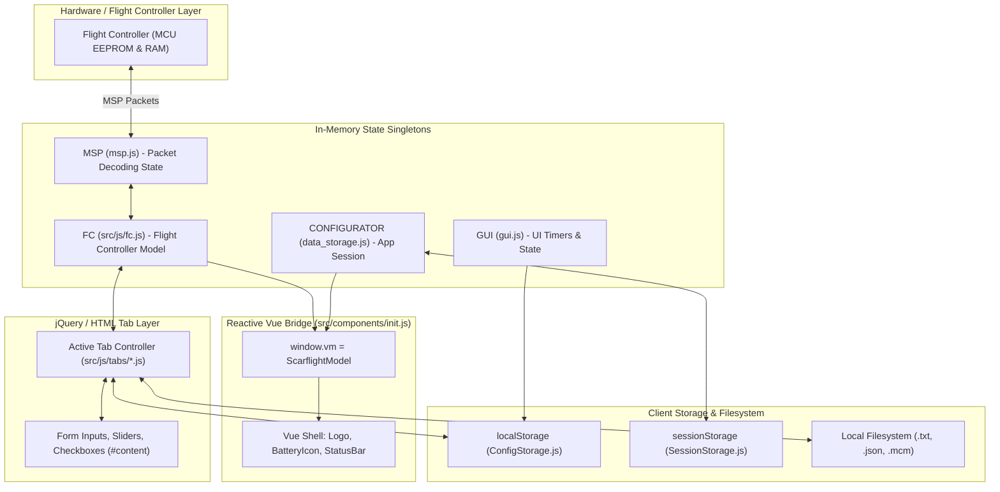

# 07 — State Management, Storage & Data Flow

This document details the state-management architecture, reactive data bridges, in-memory models, and persistence mechanisms across Scarflight Configurator.

---

## 1. State Management Architecture Overview

Scarflight Configurator manages state through **four primary tiers**:
1. **Hardware / Device State (`FC`)**: The ground truth representation of the connected Flight Controller in [`src/js/fc.js`](file:///c:/Users/DELL/Drone/src/js/fc.js).
2. **Application Runtime State (`CONFIGURATOR` & `GUI`)**: Execution flags, active connection references, and tab router state.
3. **Reactive UI State (`ScarflightModel` & Vue)**: Two-way binding between the global data models and Vue components.
4. **Persistent Client Storage (`ConfigStorage` & `SessionStorage`)**: Browser `localStorage` and `sessionStorage` key-value engines.

---

## 2. In-Memory State Models

### 2.1. The Flight Controller Data Model (`FC` in `src/js/fc.js`)
The `FC` object contains complete operational state divided into structured sub-models:

| Model Property | Data Type | Origin / Source | Description | Reset Behavior |
| :--- | :--- | :--- | :--- | :--- |
| `FC.CONFIG` | Object | `MSP_STATUS`, `MSP_BOARD_INFO`, `MSP_BUILD_INFO` | Hardware identifier, firmware version, cycle time, CPU load, I2C errors, craft name, arming disable flags. | Cleared by `FC.resetState()` on disconnect. |
| `FC.ANALOG` | Object | `MSP_ANALOG` (periodic poller) | Live battery voltage (mV), current draw (mA), mAh drawn, RSSI level. | Cleared by `FC.resetState()`. |
| `FC.BATTERY_CONFIG`| Object | `MSP_BATTERY_CONFIG` | Min/max cell voltage, warning voltage, capacity, voltage meter source. | Reset on disconnect. |
| `FC.FEATURE_CONFIG`| Object | `MSP_FEATURE_CONFIG` | Bitmask of enabled flight features (`OSD`, `GPS`, `LED_STRIP`, `TELEMETRY`, etc.). | Reset on disconnect. |
| `FC.MOTOR_DATA` | Array(8) | `MSP_MOTOR` | Real-time throttle pulse widths (1000–2000) sent to individual ESCs. | Reset on disconnect. |
| `FC.SENSOR_DATA` | Object | `MSP_RAW_IMU` | Raw X/Y/Z readings for Gyroscope, Accelerometer, and Magnetometer. | Reset on disconnect. |
| `FC.GPS_DATA` | Object | `MSP_RAW_GPS` | GPS fix status, number of satellites, latitude, longitude, speed, ground course. | Reset on disconnect. |
| `FC.ATTITUDE` | Object | `MSP_ATTITUDE` | Estimated roll, pitch, and heading in degrees (feeds Three.js 3D model). | Reset on disconnect. |
| `FC.RC` | Object | `MSP_RC` | Real-time radio channel inputs (Aileron, Elevator, Throttle, Rudder, Aux 1–12). | Reset on disconnect. |

### 2.2. Application Session Model (`CONFIGURATOR` in `src/js/data_storage.js`)
- `connectionValid` (Boolean): True once handshake sequence successfully validates an active Scarflight board.
- `virtualMode` (Boolean): True when running against `VirtualFC.js` simulated hardware.
- `virtualApiVersion` (String): Simulated MSP API version selected by user (e.g. `1.46.0`).
- `cliActive` / `cliValid` (Boolean): Indicates whether the serial port is engaged in raw CLI terminal mode.
- `version` / `gitRevision`: Read from `package.json` or Vite compile-time definitions (`__APP_VERSION__`, `__APP_REVISION__`).

---

## 3. Persistent Client Storage

### 3.1. Local Storage Engine (`ConfigStorage.js`)
Stores persistent user preferences in browser `localStorage`. Values are JSON-serialized:

| Storage Key | Data Type | Default Value | Purpose |
| :--- | :--- | :--- | :--- |
| `expertMode` | Boolean | `false` | Toggles display of advanced PID filters, developer tools, and CLI features. |
| `darkTheme` | Number | `2` (Auto) | Theme selection: `0` = Light, `1` = Dark, `2` = Follow System Preference. |
| `rememberLastTab` | Boolean | `false` | When true, Configurator automatically navigates to `lastTab` upon connection. |
| `lastTab` | String | `tab_setup` | Class name of the last visited tab (e.g. `tab_pid_tuning`). `cli` is excluded. |
| `cliAutoComplete` | Boolean | `true` | Enables auto-completion dropdown in CLI terminal tab. |
| `logopen` | Boolean | `false` | Persists whether the top log drawer is expanded or collapsed. |
| `portOverride` | String | `/dev/rfcomm0`| Manual serial port path override (for Bluetooth / RFCOMM ports). |
| `showAllSerialDevices` | Boolean | `false` | If enabled, disables USB VID/PID filtering, showing all system serial ports. |
| `useMdnsBrowser` | Boolean | `false` | Enables background mDNS polling for wireless ExpressLRS receivers. |
| `erase_chip` | Boolean | `true` | Default flag in firmware flasher to force full chip erase before flashing. |

### 3.2. Session Storage Engine (`SessionStorage.js`)
Uses browser `sessionStorage` for ephemeral network caching:
- `https://build.Scarflight.com/api/targets_Data`: Cached target manifests.
- `https://build.Scarflight.com/api/targets_LastUpdate`: Timestamp ensuring cached manifests expire after 1 hour (`3600 * 1000 ms`).

### 3.3. Filesystem Persistence & Text File Exports
- **Configuration Backups**: JSON files (`.json`) containing complete flight controller dumps parsed by `backup_restore.js`.
- **CLI Dumps**: Plain text files (`.txt`) exported from `#save_to_file_btn` containing `diff all` or `dump` scripts.
- **VTX Tables**: JSON documents defining frequency bands, channel megahertz mappings, and power levels.
- **OSD Font Bitmaps**: Binary `.mcm` character map files uploaded directly to onboard MAX7456 OSD chips.
