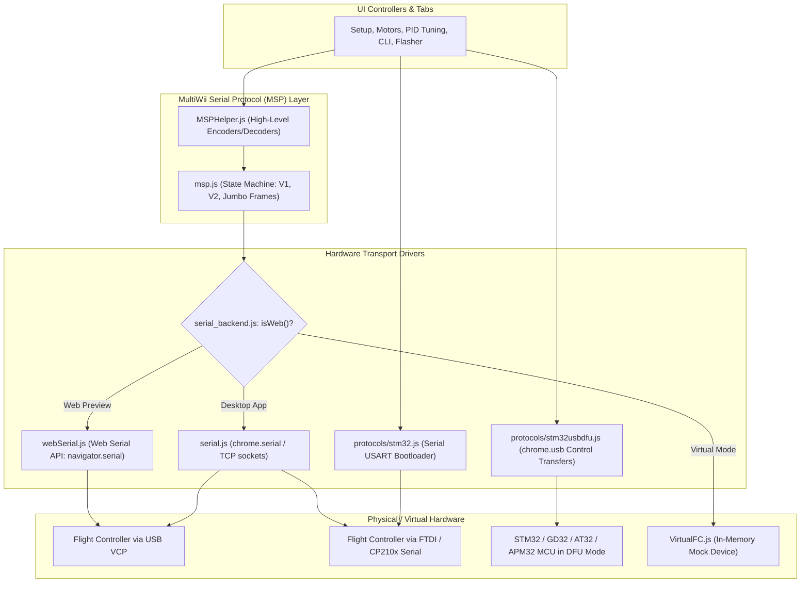

# 08 — Services, Device Communication & External Integrations

This document details all communication layers, protocol encoders/decoders, native device interfaces, and external HTTP APIs integrated into Scarflight Configurator.

---

## 1. Device Communication Architecture



---

## 2. MultiWii Serial Protocol (MSP) Implementation

The MultiWii Serial Protocol (MSP) is the core binary communication pipeline between Configurator and flight controller firmware.

### 2.1. Frame Formats

#### MSP V1 Frame Format
```text
+---+---+---+--------+------+---------+----------+
| $ | M | < | Length | Code | Payload | Checksum |
+---+---+---+--------+------+---------+----------+
 1B  1B  1B    1B       1B    0-255B       1B
```
- Direction byte: `<` (outbound to FC), `>` (inbound from FC), `!` (unsupported command error).
- Checksum: 8-bit XOR over `Length ^ Code ^ Payload bytes`.

#### MSP V2 Frame Format
```text
+---+---+---+-------+------+---------+----------+-------+
| $ | X | < | Flags | Code | Length  | Payload  | CRC8  |
+---+---+---+-------+------+---------+----------+-------+
 1B  1B  1B    1B     2B       2B       0-65535B    1B
```
- Code and Length are 16-bit little-endian words.
- Checksum: DVB-S2 CRC-8 polynomial (`0xD5`).

#### Jumbo Frame Format
When an MSP V1 payload exceeds 255 bytes (e.g. `MSP_BOXIDS` or large OSD layout buffers), the V1 length is set to `255`, immediately followed by a 16-bit true length.

### 2.2. Critical MSP Codes Handled

| Code | Symbol | Direction | Purpose & Data Payload |
| :---: | :--- | :---: | :--- |
| **1** | `MSP_API_VERSION` | Inbound | Handshake: returns MSP protocol version and API major.minor. |
| **2** | `MSP_FC_VARIANT` | Inbound | Handshake: returns `'BTFL'` flight controller identifier string. |
| **3** | `MSP_FC_VERSION` | Inbound | Handshake: returns firmware version (e.g. 4.5.0). |
| **4** | `MSP_BOARD_INFO` | Inbound | Handshake: returns board identifier, hardware name, signature. |
| **5** | `MSP_BUILD_INFO` | Inbound | Handshake: returns git revision hash, build date, and build options. |
| **101** | `MSP_STATUS` | Inbound | Telemetry: cycle time, I2C errors, active sensors, arming flags. |
| **102** | `MSP_RAW_IMU` | Inbound | Telemetry: raw 16-bit gyro, accelerometer, magnetometer samples. |
| **105** | `MSP_RC` | Inbound | Telemetry: channel pulse widths for Roll, Pitch, Yaw, Throttle, Aux. |
| **108** | `MSP_ATTITUDE` | Inbound | Telemetry: calculated Pitch, Roll (-180° to 180°), Yaw (0° to 360°). |
| **110** | `MSP_ANALOG` | Inbound | Telemetry: battery voltage, mAh consumed, amperage, RSSI. |
| **111** | `MSP_PID` | Bidirectional | Reads or updates P, I, D coefficients across all axes. |
| **214** | `MSP_SET_MOTOR` | Outbound | Direct motor bench testing (overrides receiver throttle). |
| **217** | `MSP_SET_PID` | Outbound | Commits updated PID tuning parameters to volatile RAM. |
| **250** | `MSP_EEPROM_WRITE` | Outbound | Commits volatile RAM configuration changes to MCU EEPROM flash. |

---

## 3. Firmware Flashing Protocols

### 3.1. USB DFU Protocol ([`src/js/protocols/stm32usbdfu.js`](file:///c:/Users/DELL/Drone/src/js/protocols/stm32usbdfu.js))
Uses USB Device Firmware Upgrade Class Specification over USB control endpoint 0:
- **`DETACH` (0x00)**: Requests device leave runtime mode and reboot into DFU bootloader.
- **`DNLOAD` (0x01)**: Sends 2048-byte memory pages or erase commands to internal MCU flash.
- **`UPLOAD` (0x02)**: Reads back flashed bytes for verification against hex checksum.
- **`GETSTATUS` (0x03)**: Polls status and execution timeout delays.
- **`CLRSTATUS` (0x04)**: Clears error conditions.
- **`ABORT` (0x06)**: Resets state machine to `dfuIDLE`.

### 3.2. Serial USART Bootloader Protocol ([`src/js/protocols/stm32.js`](file:///c:/Users/DELL/Drone/src/js/protocols/stm32.js))
Used for legacy STM32 chips or dedicated hardware programmers via COM port:
- Handshake byte `0x7F` sent at auto-detected baud rate.
- Verified response: `ACK` (`0x79`) or `NACK` (`0x1F`).
- Slices firmware into 256-byte blocks using command `0x31` (`write_memory`).

---

## 4. External HTTP Services & APIs

### 4.1. Scarflight Build Server (`BuildApi.js`)
- **Base Endpoint**: `https://build.Scarflight.com`
- **Endpoints**:
  - `GET /api/targets`: Returns JSON array of all supported hardware target names.
  - `GET /api/targets/{target}`: Returns releases and cloud build manifests for target.
  - `GET /api/builds/{release}/{target}`: Queries build status and artifacts.
  - `GET /api/builds/{release}/{target}/{options}`: Triggers an automated cloud build with selected radio, motor, and feature flags.
  - `POST /api/support`: Submits anonymized support dumps for troubleshooting.
- **Caching Policy**: In [`BuildApi.js:10`](file:///c:/Users/DELL/Drone/src/js/BuildApi.js#L10), responses are cached in `sessionStorage` with a 1-hour expiration timestamp.

### 4.2. Community Presets Repository
- **Base Endpoint**: `https://raw.githubusercontent.com/Scarflight/firmware-presets/master`
- Fetches `index.json` containing metadata, categories, authors, and script links for community tuning presets.

### 4.3. Google Analytics Integration (`Analytics.js`)
- Provides anonymized event tracking: application launch, selected language, expert mode toggle, tab views, and firmware flashing success/failure.
- Pilot consent is governed by privacy settings in the Privacy Policy tab.
