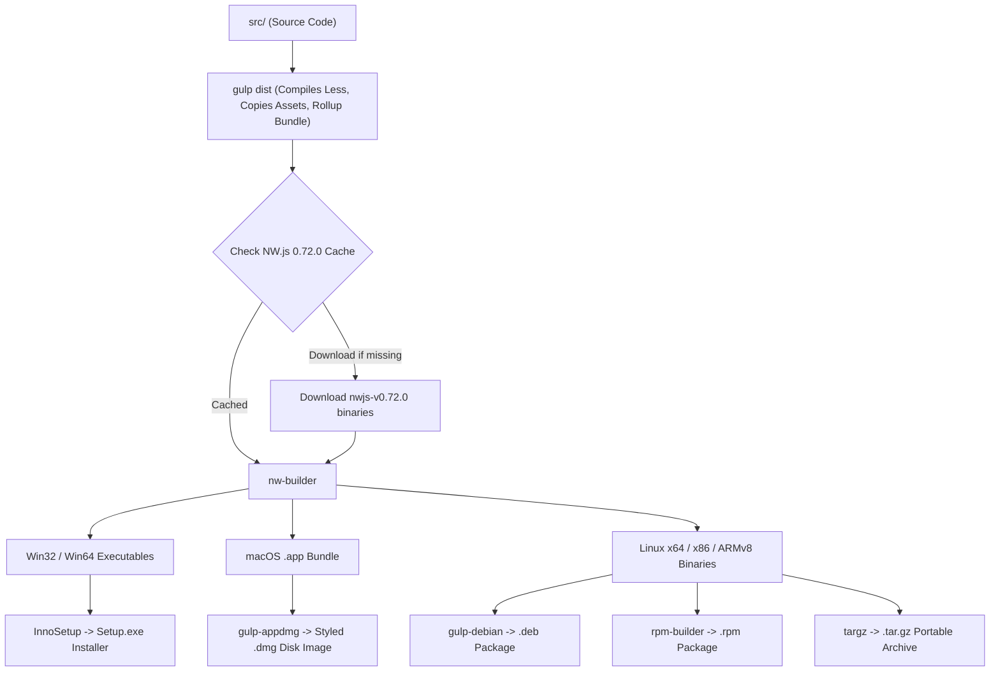

# 11 — Build, Development, Testing & Release Workflows

This document details the operational scripts, build tooling, packaging workflows, and testing infrastructure of Scarflight Configurator.

---

## 1. Development & Build Scripts (`package.json`)

| Script Name | Command Line | Primary Tool | Description & Output |
| :--- | :--- | :--- | :--- |
| `yarn dev` | `vite` | Vite 4 | Starts local development server on `http://localhost:8000` with hot module replacement (HMR). Serves `/locales/` and `/resources/` via custom plugin. |
| `yarn build` | `vite build` | Vite 4 + Rollup | Compiles web production bundle into `src/dist/`. Copies locales, resources, tabs, and images. Generates PWA service worker. |
| `yarn preview` | `vite preview` | Vite 4 | Boots a local HTTP preview server on `http://localhost:8080` serving the compiled `src/dist/` bundle. |
| `yarn review` | `vite build && vite preview` | Vite 4 | One-shot command to compile production bundle and immediately launch local preview server. |
| `yarn start` | `run-script-os` | Cross-platform | Cross-platform dispatch for starting NW.js debug desktop application. |
| `yarn start:windows` | `set NODE_ENV=development && ... && gulp debug` | Gulp + NW.js | Sets development environment variables and launches NW.js with Vue DevTools extension loaded on port 9222. |
| `yarn release` | `run-script-os` | Gulp + NW.js | Cross-platform dispatch for building production desktop installer binaries. |
| `yarn release:windows` | `set NODE_ENV=production && gulp release` | Gulp | Builds production installers for Windows (InnoSetup `.exe` and `.zip`). |
| `yarn test` | `vitest` | Vitest | Executes the unit test suite under JSDOM environment. |
| `yarn lint` | `eslint --ext .js,.vue src gulpfile.js ...` | ESLint | Runs static analysis and code linting across JS and Vue source files. |
| `yarn storybook` | `start-storybook -p 6006` | Storybook | Launches isolated component development playground for Vue UI components. |

---

## 2. Desktop Packaging & Release Pipeline (`gulpfile.js`)

Desktop packaging is orchestrated via Gulp 4 and `nw-builder` (`0.72.0`):



### 2.1. Supported Release Platforms
- **Windows**: `win32` (32-bit x86), `win64` (64-bit x64). Packaged as standalone `.zip` and InnoSetup installer executable (`Scarflight-Configurator-Installer_10.10.0_win64.exe`).
- **macOS**: `osx64` (Intel & Apple Silicon via Rosetta). Packaged as `.dmg` with custom drag-to-Applications background.
- **Linux**: `linux64` (x86_64), `linux32` (i386), `armv8` (Raspberry Pi / ARM64). Packaged as `.deb`, `.rpm`, and `.tar.gz`.
- **Android**: `android` via Apache Cordova (`dist_cordova/`). Outputs debug and release `.apk` files signed via `cordova/debug.keystore`.

---

## 3. Unit Test Verification (Vitest)

The unit test suite was executed in read-only mode during this audit:
- **Runner**: Vitest `v0.27.3`
- **Environment**: JSDOM with custom setup in [`test/setup.js`](file:///c:/Users/DELL/Drone/test/setup.js)
- **Execution Command**: `npx vitest run`

### 3.1. Test Execution Results (100% Passed)
```text
 ✓ test/js/msp/MSPHelper.test.js  (5 tests) 69ms
 ✓ test/js/msp.test.js            (4 tests) 1696ms
 ✓ test/tabs/cli.test.js          (13 tests) 66ms

 Test Files  3 passed (3)
      Tests  22 passed (22)
   Duration  48.20s
```

### 3.2. Test Coverage Analysis
1. **`test/js/msp/MSPHelper.test.js`**:
   - Verifies MSP payload unpacking.
   - Confirms rejection of corrupt packets with CRC errors.
   - Tests `MSP_BOARD_INFO` decoding.
2. **`test/js/msp.test.js`**:
   - Tests low-level state machine byte stream decoding.
   - Validates MSP v1 XOR checksum verification.
   - Validates MSP v2 CRC-8 DVB-S2 verification.
3. **`test/tabs/cli.test.js`**:
   - Validates CLI line buffering and command queueing.
   - Tests autocomplete dictionary lookup and command history traversal.
